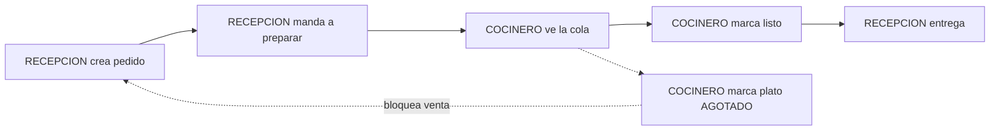

# Modelo de Negocio

> [!abstract] Fuentes
> `docs/Flujo - Recepcion Cocina.md` (decisión con el dueño, 2026-10-02), `docs/FRONTEND_CONTEXT.md` §3, §5, §7 y la tabla real del código `src/app/core/auth/domain/permissions.rules.ts`. El backend sigue siendo la autoridad; el front solo oculta lo que de todas formas daría 403.

Volver: [[00 - MOC]] · Relacionado: [[Seguridad]] · [[API]] · [[Glosario]]

## Multi-tenant
- Cada restaurante es un tenant. El `restauranteId` **sale del JWT** en el backend; nunca va en el JSON ni se pide en formularios (`FRONTEND_CONTEXT` §3).
- Una sesión con `restauranteId === null` es de **plataforma**; con valor, de **restaurante** (`scopeOf` en `permissions.rules.ts`).

## Suscripción y paywall
- Estados de suscripción en el contrato: `ACTIVA` / `CANCELADA`; estados de restaurante: `ACTIVO` / `INACTIVO`.
- Contrato vigente en `FRONTEND_CONTEXT` §5: un tenant `CANCELADA` lee pero no escribe (402). Las fechas eran informativas.
- Hoy el front: el `errorInterceptor` redirige a `/paywall` (ADMINISTRADOR) o `/suspendido` (otros) ante un 402. Ver [[Seguridad]] y [[Restaurante]].

> [!success] Modelo vigente en el backend (verificado contra su código, 2026-10-16)
> - `CANCELADA` significa "no renovar": sigue operando hasta `fechaFin`.
> - El 402 aplica solo si el restaurante está `INACTIVO`, no tiene suscripción vigente o `fechaFin < hoy`.
> - El tenant no renueva ni cambia de plan: lo hace la plataforma cuando recibe el pago.
> - Un período dura **un mes calendario** y `fechaFin` es **inclusiva** (11/10 a 10/11; la renovación arranca el 11/11). Un demo de N días da N días.
> - Todo corre en hora de Lima.
>
> El front ya aplica este modelo: el tenant no renueva (paywall manual), `isTenantWriteBlocked` no bloquea una `CANCELADA` vigente y Plataforma deriva "vencida" con `fechaFin` inclusiva en hora de Lima (`isVencida`). Ver [[API]] y [[Plataforma]].

## Roles
Vocabulario cerrado (`src/app/core/auth/auth.types.ts`):

| Ámbito | Roles | Observación |
|---|---|---|
| Plataforma | `SUPERADMIN`, `ADMIN`, `MODERADOR` | jerarquía `SUPERADMIN > ADMIN > MODERADOR`: nadie otorga un rol igual o superior (`canGrantPlatformRol`) |
| Restaurante | `ADMINISTRADOR`, `RECEPCION`, `COCINERO`, `MESERO`, `CAJERO`, `REPARTIDOR` | `MESERO/REPARTIDOR` existen sin permisos activos (YAGNI según el Flujo); `CAJERO` cobra desde la fase de Caja (ver abajo) |

### Matriz de acciones (UI)
Tomada de `permissions.rules.ts` (`PLATFORM_ACTIONS` y `RESTAURANTE_ACTIONS`). `X` = permitido.

| Acción | SUPERADMIN | ADMIN | ADMINISTRADOR | RECEPCION | COCINERO | CAJERO | MESERO / REPARTIDOR | MODERADOR |
|---|---|---|---|---|---|---|---|---|
| `plataforma.restaurantes.ver` | X | | | | | | | |
| `plataforma.restaurantes.crear` | X | X | | | | | | |
| `plataforma.suscripcion.gestionar` | X | | | | | | | |
| `plataforma.restaurantes.estado` | X | | | | | | | |
| `restaurante.ver` | | | X | X | X | X | X | |
| `restaurante.suscripcion.gestionar` | | | X | | | | | |
| `catalogo.ver` | | | X | X | X | X | X | |
| `catalogo.editar` | | | X | | | | | |
| `catalogo.disponibilidad` | | | X | | X | | | |
| `pedidos.gestionar` | | | X | X | | | | |
| `pagos.registrar` | | | X | X | | X | | |
| `pagos.reembolsar` | | | X | X | | | | |
| `usuarios.gestionar` | | | X | | | | | |
| `cocina.ver` / `cocina.listo` | | | X | X | X | | | |

> [!note] `pagos.registrar` ampliado en la fase de Caja (mergeado el 2026-10-17, PR #19)
> Antes era solo ADMINISTRADOR (así lo decía `Flujo - Recepcion Cocina.md`). Pasa a **ADMINISTRADOR, RECEPCION y CAJERO** según `FRONTEND_CONTEXT` §3, que es el contrato vigente y coincide con el backend. `pagos.reembolsar` no cambia (ADMINISTRADOR y RECEPCION). Detalle en [[Fase 7 - Caja]] y [[Pagos]].

### Permisos del backend que difieren de la matriz
Verificado contra los `@PreAuthorize` del backend (`c32dcba`, 2026-10-16) y comparado con `permissions.rules.ts` tras la fase de Caja (2026-10-17). El front solo oculta; estas diferencias esconden acciones que el backend sí permite:

| Acción | Backend | Front (matriz de arriba) |
|---|---|---|
| Listar pedidos (`GET /pedidos`) | ADMINISTRADOR, RECEPCION, CAJERO | `pedidos.gestionar` sin CAJERO (el CAJERO aterriza en `/caja`) |
| Ver restaurantes de plataforma | SUPERADMIN, ADMIN, MODERADOR | `plataforma.restaurantes.ver` solo SUPERADMIN |
| Renovar suscripción | SUPERADMIN, ADMIN, MODERADOR | `plataforma.suscripcion.gestionar` solo SUPERADMIN |
| Cambiar plan, suspender o reactivar | SUPERADMIN, ADMIN | `plataforma.suscripcion.gestionar` y `plataforma.restaurantes.estado`, solo SUPERADMIN |
| Crear usuarios de plataforma (`POST /usuarios/plataforma`) | SUPERADMIN (ADMIN o MODERADOR), ADMIN (solo MODERADOR) | sin acción |

> [!success] Ya alineado
> Cobrar (`POST /pagos`: ADMINISTRADOR, RECEPCION, CAJERO) dejó de ser una diferencia con la fase de Caja. Crear restaurante (`plataforma.restaurantes.crear`: SUPERADMIN y ADMIN) también coincide.

Jerarquía de plataforma en el backend (`RolNombrePlataforma.puedeGestionar`): cada rol solo otorga, y solo cambia el rol de quien tiene, un rol **menor** al suyo. SUPERADMIN y ADMIN (socio) tienen las mismas funciones; la única diferencia es que solo SUPERADMIN crea ADMINs. Nadie crea un SUPERADMIN ni le cambia el rol a uno. Coincide con `canGrantPlatformRol` del front.

> [!tip] Por qué RECEPCION podía reembolsar pero no cobrar
> Era la matriz original del contrato (`Flujo - Recepcion Cocina.md`). La review lo marcó como inusual pero intencional (`docs/progress/03`). **Superado en el backend** (2026-10-09) y alineado en el front con la fase de Caja: RECEPCION y CAJERO también cobran.

### Home por rol (`homeFor`)
| Rol | Destino |
|---|---|
| SUPERADMIN | `/plataforma/restaurantes` |
| ADMIN (plataforma) | `/plataforma/restaurantes/nuevo` |
| ADMINISTRADOR, RECEPCION | `/pedidos` (lista; decisión del usuario 2026-10-14) |
| COCINERO | `/cocina` |
| CAJERO | `/caja` (cambio de la fase de Caja, `feat/caja-01-datos`) |
| MODERADOR, MESERO, REPARTIDOR | `/sin-modulos` |

> [!note] Observación derivada del código
> MESERO/CAJERO/REPARTIDOR tienen `catalogo.ver`, así que el menú les muestra "Catálogo" (a CAJERO, junto a "Caja"; a MESERO y REPARTIDOR, aunque su home sea `/sin-modulos`). Es una consecuencia de las reglas actuales; no hay documentación que diga si es deseado. Ver [[Pendientes y Deuda Técnica]].

## Flujo operativo Recepción a Cocina

Un producto `AGOTADO` no se puede pedir: el backend responde 400 (`Producto no disponible: {id}`); el front puede filtrar pero la garantía es del dominio.

## Pedidos: tipos y estados
- Tipos (`TipoPedido`): `MESA` (exige `mesaId`), `DELIVERY`, `RECOJO`.
- Estados (`EstadoPedido`): `PENDIENTE`, `EN_PREPARACION`, `LISTO`, `EN_ENTREGA`, `ENTREGADO`, `CANCELADO`.
- Transiciones (doc de Flujo, regla 5): `PENDIENTE → EN_PREPARACION → LISTO → ENTREGADO` (MESA/RECOJO) o `LISTO → EN_ENTREGA → ENTREGADO` (DELIVERY); `CANCELADO` hasta `LISTO`; un pedido pagado no se cancela (400).
- Diagrama completo con actores: [[Flujo del Sistema]].

> [!success] Reglas vigentes en el backend (verificado contra su código)
> - **Cancelar un pedido** (ADMINISTRADOR o RECEPCION) no pide contraseña ni aprobación, pero solo se puede si no está pagado.
> - **Reembolso:** solo de un pago `PAGADO`. Cancela el pedido si no está `ENTREGADO`, y es definitivo: un pedido reembolsado no se vuelve a cobrar (400).
> - **DELIVERY:** `EN_ENTREGA → CANCELADO` se permite si no está pagado, y `ENTREGADO` sin pago es válido (cobro posterior).
>
> Ver [[API]].

## Qué NO existe (según `FRONTEND_CONTEXT` §9)
`MeResponse.suscripcionVigente`, filtros en el dashboard de plataforma, `PUT` de edición de pedido, entidad `mesa`, facturación/SUNAT. Y el listado `GET /usuarios` (backlog backend, `docs/progress/01`). `GET /pedidos` sí existe (verificado el 2026-10-11) y lo usa la lista de [[Pedidos]]; sigue sin existir `GET /pedidos/{id}`. Nota: §9 aún dice que no hay WebSockets de cocina, pero §7 del mismo documento ya los describe (ver [[Pendientes y Deuda Técnica]]).
